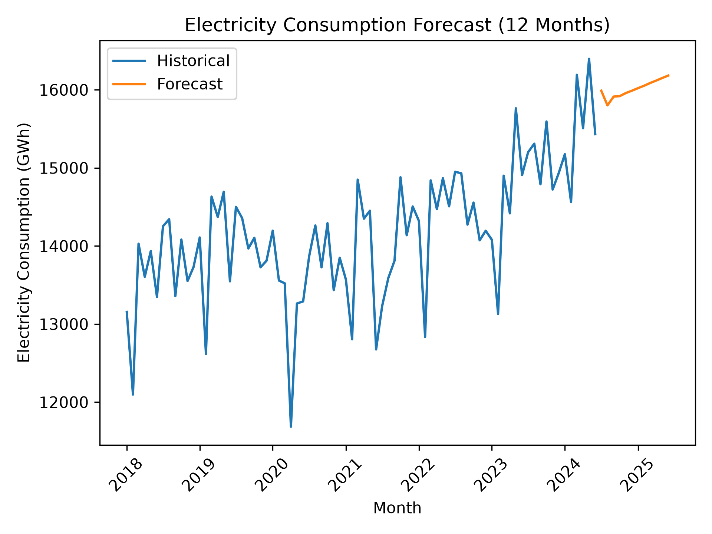

# Malaysian Electricity Demand Forecasting

A group project that applies linear algebra to forecast monthly electricity consumption in Malaysia. The model uses consumption from the previous three months to estimate the next month's demand.

## Project overview

The project uses historical electricity consumption data to:

- Explore monthly consumption trends.
- Estimate a three-lag linear model using least squares and LU decomposition.
- Analyse the model's transition matrix using eigenvalues.
- Produce a 12-month forecast and compare predictions with actual values.

The dataset contains 468 records across six sectors. The model uses the 78 records labelled `total`, covering January 2018 to June 2024. The project report identifies the data source as the Department of Statistics Malaysia via [data.gov.my](https://data.gov.my/).

## Model evaluation

To test the model on unseen data, the final 12 months were held out. The model was trained on earlier observations and compared against a simple baseline that predicts the previous month's consumption.

| Method | Test MAE |
|---|---:|
| Three-lag linear model | 439.95 GWh |
| Previous-month baseline | 652.96 GWh |

These are **one-month-ahead** predictions using actual previous observations. They do not measure the accuracy of the separate recursive 12-month forecast. The actual-versus-predicted graph shows **in-sample** predictions.

## Forecast

The original model produces a recursive forecast for the 12 months after June 2024. This is a historical model exercise rather than a current forecast.



## Tools

Python, pandas, NumPy, SciPy, Matplotlib and scikit-learn.

## How to run

Install the required libraries:

```bash
python -m pip install pandas numpy scipy matplotlib scikit-learn
```

Run the script from the project folder:

```bash
python maths3.py
```

The script prints the results and saves three graphs in the `outputs` folder. Close each graph window to display the next one.

## Limitations

The model uses past consumption only; it does not include weather, economic conditions or explicit seasonal variables. The test covers one 12-month period, so further validation is needed. The dominant eigenvalue is slightly greater than one, indicating slow growth under repeated application of the fitted model—not a guarantee of real-world growth.

## Team

This project was completed as a group assignment for Mathematics for Computing III:

- Amni Nuwairah binti Abdul Hanan
- Yasmin Hanani Salsabila binti Md Hakiim
- Noor Zafirah Alya binti Noor Shizarin
- Syarah Alya binti Mohamad Zamri
- Farah Amirah binti Abdul Muin